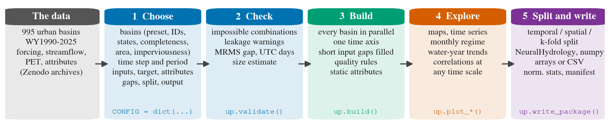
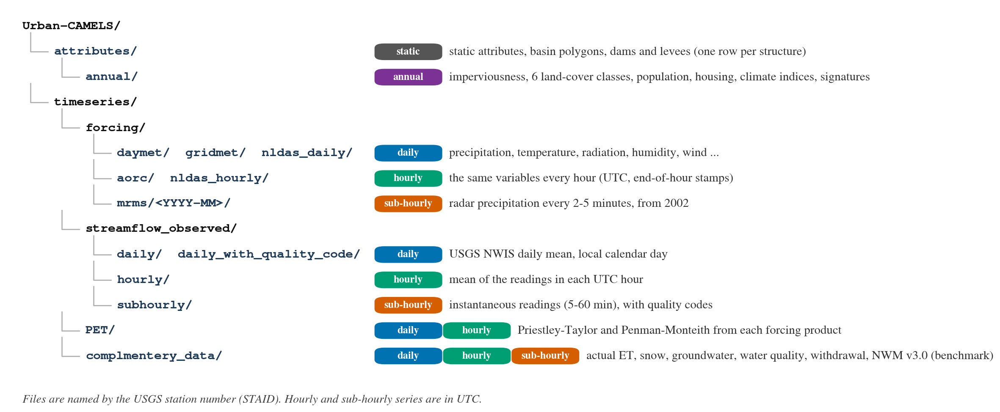
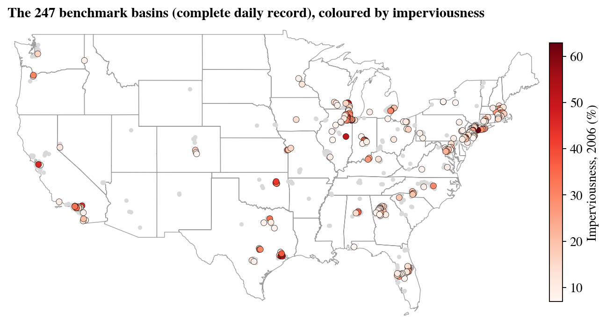
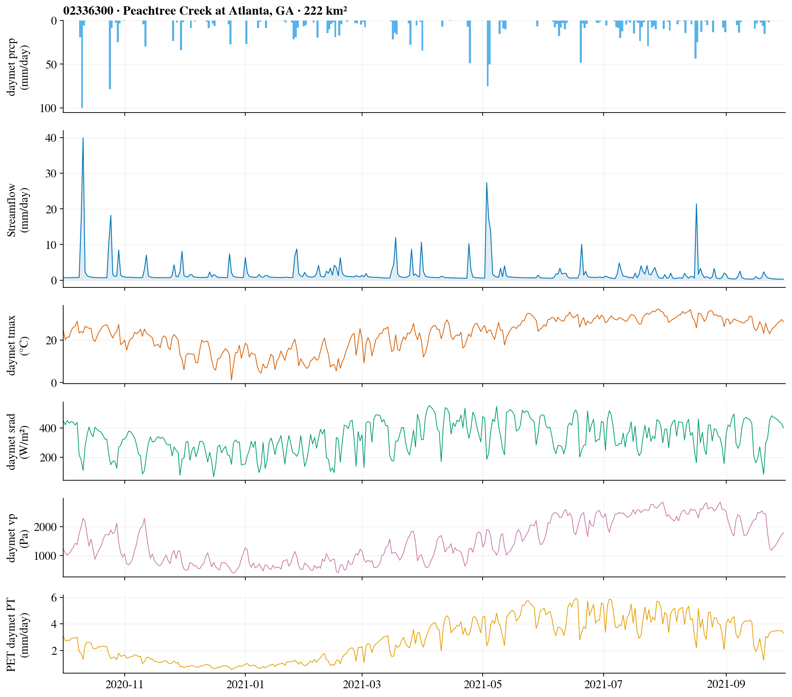
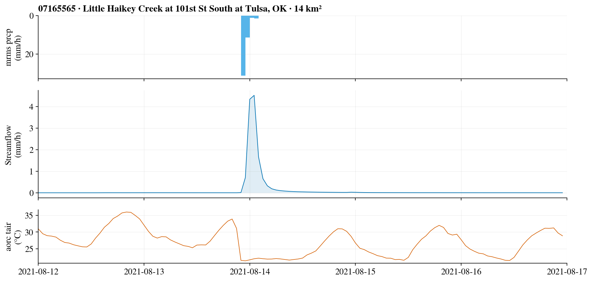
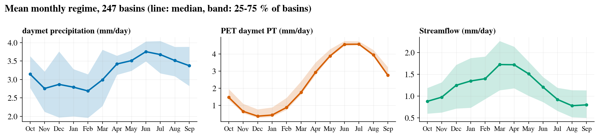
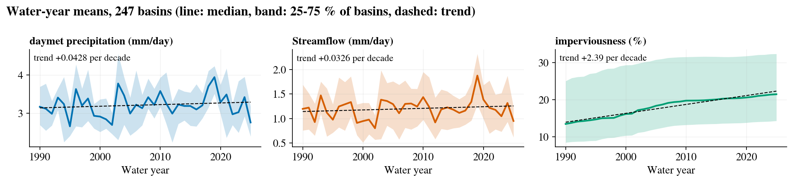
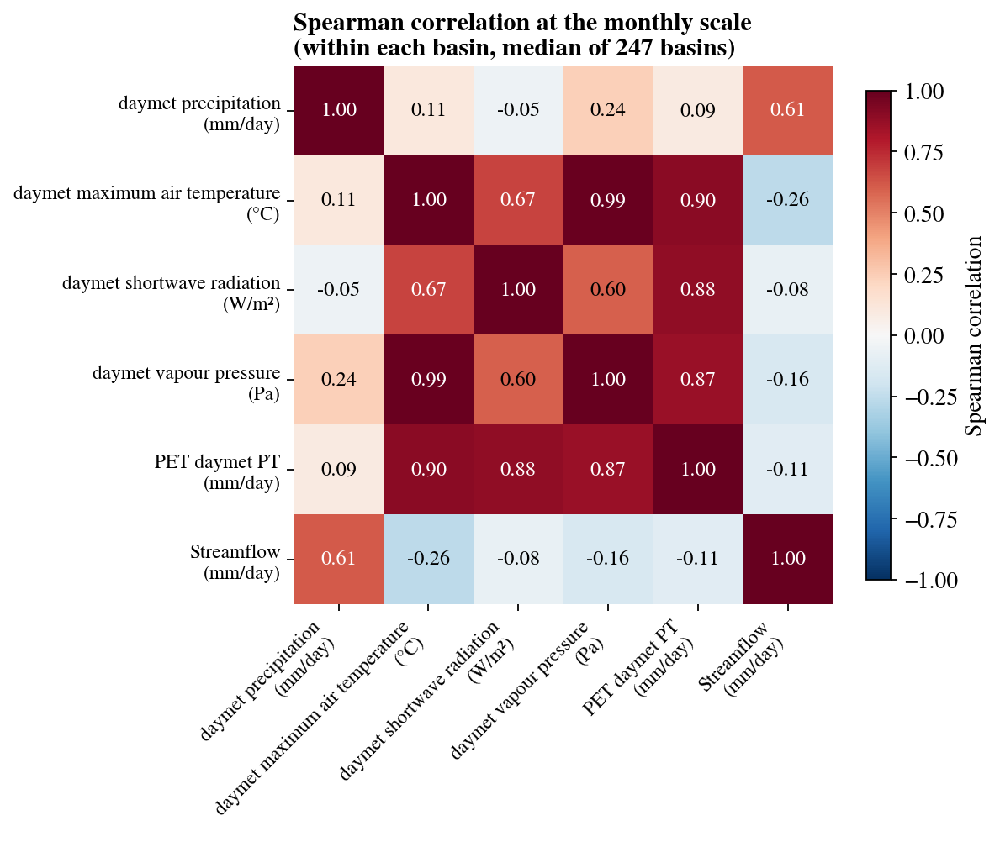

# Urban-CAMELS data-preparation toolkit

Build a model-ready dataset from Urban-CAMELS (995 urban basins, water years 1990 to 2025) at a **daily, hourly or
sub-hourly** time step. You choose:
- the basins;
- the period;
- the inputs and target;
- the attributes;
- the split;
- the output format.

The toolkit checks, assembles, splits and packs the data, and draws maps and plots to explore it.



## Install
Python 3.9 or later with `pandas`, `numpy` and `xarray` (with `netCDF4` or `scipy`), plus `jupyter` for the notebook
and `matplotlib` for the maps and plots:

    pip install pandas numpy xarray netCDF4 matplotlib jupyterlab

## Get the data
Download the Urban-CAMELS archives and unzip them all into one folder. The folder then holds:

    Urban-CAMELS/
      timeseries/forcing/{daymet,gridmet,nldas_daily,nldas_hourly,aorc,mrms}/
      timeseries/streamflow_observed/{daily,hourly,subhourly}/
      timeseries/PET/
      timeseries/complmentery_data/
      attributes/

The toolkit only needs the archives for the products you use, plus `attributes`.



To see every variable you can choose, with its unit, source, period and the time steps it can be used at:

```python
import ucamels_prep as up
up.variables()          # 73 rows: forcing, PET, annual attributes and the target
up.static_groups()      # static attribute groups and their columns
```

## Start here
Open **`Urban_CAMELS_data_prep.ipynb`** from this folder. Set `DATA_ROOT` in the first cell to the data folder (or set
the environment variable `UCAMELS_DATA`), edit the cells marked **EDIT**, then run all cells.

Basins are read in parallel, so 4 to 8 CPU cores help. Memory depends on the build:
- a daily build of the 247 benchmark basins needs well under 4 GB and runs in under a minute;
- an hourly build of about 500 basins over WY2008-2025 needs about 12 GB and takes about 3 minutes.

## Use from a script
The notebook only fills one CONFIG dictionary and calls five functions:

```python
import ucamels_prep as up

CONFIG = dict(
    data_root='/path/to/Urban-CAMELS',
    resolution='daily', period=('1989-10-01', '2025-09-30'),
    basins=dict(preset='benchmark_247'),
    forcing={'daymet': ['prcp', 'tmax', 'tmin', 'srad', 'vp']}, pet={'daymet': ['pet_pt']},
    dynamic_attributes=['imperv'], target=dict(unit='mm'),
    static_attributes=dict(groups=['location_topography', 'soil', 'climate'], from_training_period=True),
    gap_fill=dict(max_steps=2, precip='zero'), qc=dict(max_target_missing_pct=10),
    split=dict(method='temporal', train=('1989-10-01', '2005-09-30'),
               validation=('2005-10-01', '2010-09-30'), test=('2010-10-01', '2025-09-30')),
    output=dict(dir='urban_camels_dataset', format='neuralhydrology'))

up.validate(CONFIG)
basins = up.select_basins(CONFIG['basins'])
tables, static, report = up.build(CONFIG, basins)
split = up.make_split(list(tables), CONFIG)
up.write_package(tables, static, report, split, CONFIG)
```

## Explore the data
After `up.build()`, the notebook draws the dataset you built, at your time step. The same functions work in a script:

| Function | What it shows |
|---|---|
| `up.plot_map(basins, color=...)` | the selected basins on a map, coloured by imperviousness, area or megaregion |
| `up.plot_timeseries(tables, sid, period=...)` | one basin: precipitation, streamflow and the other inputs |
| `up.plot_monthly(tables)` | the mean seasonal cycle of every variable over all basins |
| `up.plot_annual(tables)` | water-year means and their trend, including imperviousness and land cover |
| `up.plot_correlation(tables, freq=...)` | correlation between variables at the built step, or weekly, monthly or annual |
| `up.plot_scatter(tables, x, y, freq=...)` | two variables against each other over all basins |

Correlations are computed inside each basin and the median over basins is shown, so differences in climate or size
between basins do not create correlation. The examples below are the 247 benchmark basins at the daily step, and one
storm at the hourly step with MRMS radar precipitation.








## Files
| File | Purpose |
|---|---|
| `Urban_CAMELS_data_prep.ipynb` | the notebook: settings, checks, build, quality report, split, write, read-back |
| `ucamels_prep.py` | the toolkit (functions used by the notebook; can also be imported in scripts) |
| `catalog/basins_995.csv` | per basin: name, state, location, area, imperviousness, megaregion, benchmark preset, data flags |
| `catalog/coverage_{daily,hourly,subhourly}.csv` | streamflow completeness (%) per basin for 13 water-year windows |
| `catalog/us_states_outline.csv` | state outlines for the maps (no geopandas needed) |
| `docs/images/`, `docs/make_readme_figures.py` | the figures of this README and the script that draws them |
| `tests/test_toolkit.py` | checks against the data files: values at every time step, every basin filter, gap filling, splits, output round-trips, and a full 995-basin daily build. Run `python tests/test_toolkit.py /path/to/Urban-CAMELS` |
| `tests/run_notebook.py` | runs every cell of the notebook without Jupyter |

## What the toolkit offers
| Choice | Options |
|---|---|
| Basins | presets `all` (995) and `benchmark_247` (complete daily record WY1990-2025); explicit IDs or a file; a completeness rule (resolution, water-year window, threshold), for example hourly streamflow ≥ 90 % over WY2004-2025; states (e.g. `states=['PA']`); area, imperviousness and megaregion filters; `exclude_flags` |
| Time step | `daily` (one row per date), `hourly` (UTC), `subhourly` (UTC; 5, 10, 15 or 30 min); hourly and sub-hourly rows describe the step that starts at the label |
| Forcing | daily: Daymet, gridMET, NLDAS daily (UTC day), AORC and NLDAS hourly aggregated to the local day. Hourly and sub-hourly: AORC, NLDAS-2 hourly, MRMS radar (2002 onward) |
| PET | Priestley-Taylor and Penman-Monteith from each forcing product |
| Dynamic attributes | annual imperviousness, 6 land-cover classes and population density, plus housing density (census years 1990-2020, held or interpolated) |
| Target | observed streamflow: mm per step, mm/h, m³/s or ft³/s; missing values stay NaN |
| Static attributes | groups: topography, soil, geology (numeric and categorical), vegetation, climate, hydrologic signatures, dams, levees. Climate attributes and signatures can be recomputed over the training years only |
| Gaps | inputs only; short gaps filled (precipitation with zeros or linearly, others linearly); a basin is dropped by rule |
| Split | `temporal`, `spatial` (random or stratified), `spatial_kfold`, `temporal_spatial` |
| Output | `neuralhydrology` (netCDF per basin, attributes, basin files, starting config), `arrays` (numpy, written to disk), `csv` |

Every package also contains:
- `splits/`
- `normalization_stats.json` (computed on the training basins and period only)
- `quality_report.csv`
- `static_attributes.csv`
- `manifest.json` (every choice, with units and time conventions)

## Features of the data and how the toolkit handles them
All 995 basins were checked for every product: presence, header, time axis, duplicates, length, gaps and physical
ranges. There are no duplicate or unsorted time stamps and no impossible forcing values. Points to know:

| Feature | Handling |
|---|---|
| **Negative hourly streamflow in 34 tidal or lake-affected gauges** (e.g. Cedar River at Jacksonville, Milwaukee River at mouth) | flag `negative_hourly_q`; negative values become NaN in the target |
| **No daily streamflow in 86 basins** (53 have no daily record, 33 have a daily file without values) | their target is all NaN; `qc.max_target_missing_pct` drops them |
| **NLDAS daily is summed over UTC days** (00-24 UTC), not local days (5-8 h shift against the streamflow) | the toolkit warns; use `nldas_hourly`, which it aggregates to the local standard-time day |
| **Daymet leaves 31 December of leap years empty** (9 days) | filled when `gap_fill.max_steps >= 1` |
| **AORC misses whole days**: 18 June 2024 everywhere, plus a few regional multi-day gaps (e.g. 7-11 July 2007); hourly AORC PET omits the same hours | short gaps are filled; longer ones stay NaN and are reported (or drop the basin) |
| **MRMS has no data from January 2012 to October 2014** | the toolkit warns when the period overlaps |
| **Streamflow signatures describe the observed flow** | leakage warnings; recompute them over the training years, and never use them for held-out basins |

Units of three static attributes: `slope_mean` m km⁻¹, `soil_conductivity` cm h⁻¹, `max_water_content` m.

## Time conventions
| Series | Time stamp in the files | What the toolkit does |
|---|---|---|
| NWIS daily streamflow | local calendar day | used as is |
| NWIS hourly streamflow | UTC, start of the hour (mean of readings in the hour) | used as is |
| NWIS sub-hourly streamflow | UTC, instantaneous | averaged over each step, labelled by its start |
| AORC, NLDAS-2 hourly (and hourly PET from them) | UTC, **end** of the hour | moved back one hour, so row t = hour t..t+1 |
| MRMS | UTC, instantaneous rates every 2-5 min | averaged over each step, labelled by its start |
| NLDAS-2 daily | UTC day, 00-24 UTC | used as is (warning) |
| Daymet, gridMET daily | the date; precipitation matches the 24 h starting near 12 UTC best (median r 0.94 and 0.90 against AORC, vs 0.81 and 0.84 for the local day) | used as is; a known feature of these products |

Empirical basis (60 random basins): AORC and NLDAS-2 hourly precipitation agree best at lag 0 (r 0.85); MRMS hour-start
means agree best with AORC one hour later (r 0.92 vs 0.52 at lag 0), so AORC stamps the end of the hour.
