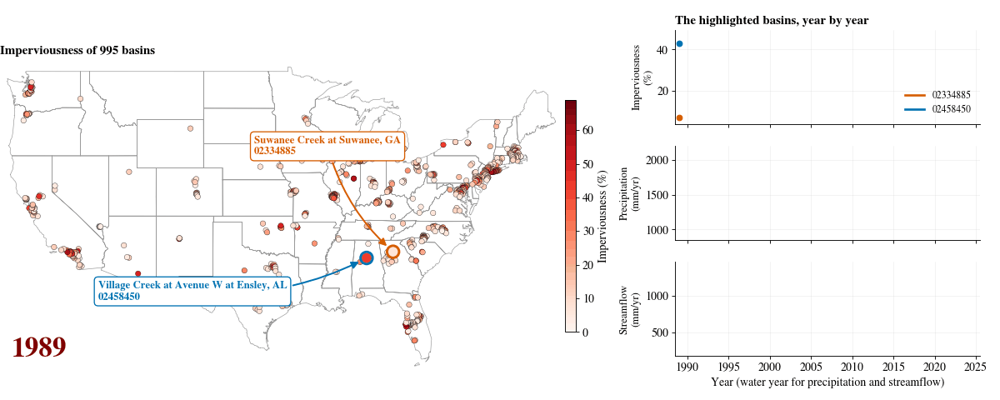
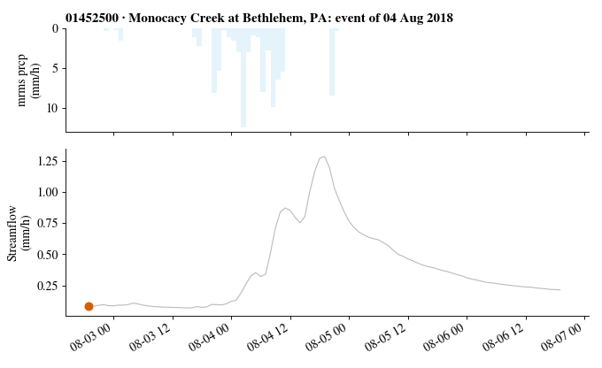

# Urban-CAMELS app (marimo)

The same toolkit as the Jupyter notebook, as an interactive app: every choice is a menu, slider or date picker, the map
and the checks update as you click, and the data are explored in tabs. It runs on your computer with your own copy of
the Urban-CAMELS data.

## Install and run

    pip install marimo altair pandas numpy xarray netCDF4 matplotlib
    marimo run marimo/urban_camels_app.py

The app opens in your browser. Type the folder that holds your unzipped Urban-CAMELS archives (`timeseries/` and
`attributes/`) in the first field, or set it before starting:

    export UCAMELS_DATA=/path/to/Urban-CAMELS        # Windows: set UCAMELS_DATA=C:\path\to\Urban-CAMELS

Use `marimo edit marimo/urban_camels_app.py` to see and change the code. Choosing basins and the map work without the
data; building, the animations and the plots need it.

On a remote computer or cluster, start the app on the compute node and open the port from your own computer:

    marimo run marimo/urban_camels_app.py --headless --host 0.0.0.0 --port 2718
    ssh -L 2718:<compute-node>:2718 <user>@<login-host>         # then open http://localhost:2718

## What it does

| Section | |
|---|---|
| Basins | start from all 995 or the 247 benchmark basins; filter by state, megaregion, imperviousness, area and streamflow completeness; live map |
| Urbanization | animated map of imperviousness from 1989 to 2025 for the selected basins, with the median and middle half |
| Time step, inputs, target | daily, hourly or sub-hourly; only the products and PET valid for the step are offered |
| Attributes, gaps, split, output | static groups, gap filling, quality rules, temporal / spatial / k-fold split, NeuralHydrology, arrays or CSV |
| Check | errors and warnings appear as you choose; **Build** is enabled when the choices are valid |
| Reproduce | the Python code for your choices, and downloads of the configuration (JSON), the basin list and a script |
| Explore | map, time series, interactive time series (zoom, pan, hover), storm replay (animated), monthly regime, water-year trends, correlation at any time scale, scatter |
| Write | saves the package, as the notebook does |

